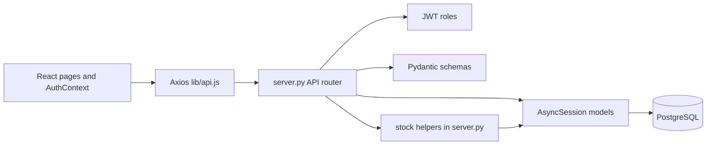

# ShambaManager architecture and inventory

> **Updated 2026-11-08:** the Herd Tag Registry integration was removed from the application (docs/decisions/0007). Content below was trimmed accordingly; line numbers are from the 2026-10-08 snapshot and have shifted. Treat anything still mentioning the Registry as historical.

Snapshot: 2026-10-08, main 9b72555, tag pre-analysis-20261008. Actual folder is livestock-mgs, not livestock-manager.
This audit reads source only. No tests, app startup, migration, database connection or deployed call was run during this analysis.

## Inventory
Counts cover tracked text before these docs; physical lines include blanks/comments. Excluded: lockfiles, .env/example values, logs, binaries/data dumps, sampe.txt, dependencies and generated directories.
| Language/type | Files | Lines |
|---|---:|---:|
| Python | 19 | 8501 |
| JavaScript | 13 | 4167 |
| JSX | 62 | 12034 |
| CSS | 2 | 78 |
| HTML | 1 | 134 |
| JSON | 5 | 1210 |
| Markdown | 5 | 338 |
| Text requirements/commands | 2 | 134 |
| YAML | 1 | 11 |
| Dockerfile | 2 | 37 |
| Nginx config | 1 | 11 |
| Other tracked config/empty marker | 5 | 120 |
| Total | 118 | 26775 |

Two-level map (excluded directories omitted; source subdirectories collapsed):
```text
livestock-mgs/
  .claude/                 (empty at audit start)
  .vscode/                settings.json (local editor configuration)
  backend/                auth.py, database.py, models.py, schemas.py, server.py,
                          seed_data.py, requirements.txt, Dockerfile,
                          .dockerignore, tests/
  frontend/               src/, public/, plugins/, package.json, Dockerfile,
                          cloudbuild.yaml, nginx.conf, craco.config.js, tailwind.config.js,
                          postcss.config.js, jsconfig.json, components.json, README.md,
                          .dockerignore, .gitignore
  memory/                 PRD.md, .gitkeep
  README.md               README_DEPLOY_GCP.md, commands.txt, .gitignore,
                          backend_test.py, backend_test_results.json,
                          design_guidelines.json, test_result.md
```
Data/log artifacts exist but are not application source; backend/sampe.txt and local database files were not analyzed.
Entry points: `backend/server.py:61` (FastAPI app); `frontend/src/index.js:1` -> App; backend Docker CMD `backend/Dockerfile:15`.
Backend: FastAPI 0.110.1 / SQLAlchemy 2.0.46 / asyncpg; Pydantic 2.12.5 (`backend/requirements.txt:23`, `:85`, `:111`).
Frontend: React 19, Router 7, Tailwind 3, CRA 5 + CRACO, Radix/shadcn-style JSX, Axios, Recharts (`frontend/package.json:5`).
Local: from backend run `python -m uvicorn server:app --reload --port 8000`; from frontend run `npm start`. Configure environment first; startup performs DDL and seeding.
Build: `npm run build` in frontend. It includes configured ESLint checks; there is no standalone lint script (`frontend/package.json:59`, `frontend/craco.config.js:33`).
Deploy: two containers (Python API, Nginx React). Backend build/deploy commands are in CLAUDE.md; frontend uses `gcloud builds submit --config cloudbuild.yaml .` from frontend (`frontend/cloudbuild.yaml:1`).
Medium: deploy guide specifies us-central1, whereas supplied target context says africa-south1; live region is unverified (`README_DEPLOY_GCP.md:24`, `:42`). Frontend's guide uses a build-arg CLI form; use the existing Cloud Build YAML for the Docker build argument (`README_DEPLOY_GCP.md:35`, `frontend/cloudbuild.yaml:7`).

## Environment names only
- Database: DATABASE_URL (`backend/database.py:36`).
- User authentication: JWT_SECRET (`backend/auth.py:14`).
- Browser/API: CORS_ORIGINS, REACT_APP_BACKEND_URL (`backend/server.py:87`, `frontend/src/lib/api.js:3`).
- Frontend tooling: NODE_ENV, ENABLE_HEALTH_CHECK, ENABLE_VISUAL_EDITS (`frontend/craco.config.js:7`).
- Container/runtime: PORT, PYTHONDONTWRITEBYTECODE, PYTHONUNBUFFERED (`backend/Dockerfile:5`, `:13`).
- Tests also read REACT_APP_BACKEND_URL; some tests have a remote fallback (`backend/tests/test_disease_events.py:12`). Never run the entire suite against an unverified environment.

## Layers and request flow

- Routes and most business services share the 4,174-line server.py; no repository abstraction. Dependency-injected AsyncSession is closed after requests; expire_on_commit=False; explicit execute/flush/commit (`backend/database.py:44`, `backend/server.py:927`).
- Log creation validates stock, creates events, adjusts stock and commits (`backend/server.py:957`). Editing reverses old stock then applies new stock; deletion reverses and removes locally (`:1311`, `:1446`).
- Opening balances plus events are the aggregate history. stock_levels is a mutable projection, rebuilt by recompute; animal rows are a separate individual register, not the source for every stock report (`backend/server.py:1791`, `:2812`, `:2839`, `:2967`).
- Farm-health intervals and event rows compute due dates; vaccine types can override the interval; summaries show overdue/upcoming events (`backend/server.py:3489`, `:3635`, `:3814`).
- Startup creates missing tables, adds selected nullable columns/index, seeds categories/default admin/vaccines. Avoid starting it during read-only work (`backend/server.py:98`).

## Frontend routes and state
All routes are in `frontend/src/App.js:65`; layout/navigation in `frontend/src/components/Layout.jsx:1`.
| Route | Page | UI access |
|---|---|---|
| /login | Login | Guest |
| / | Dashboard | Signed in |
| /locations, /locations/:id | Locations, LocationDetail | Signed in |
| /animals | Animals | Signed in; action roles inside page |
| /farm-health | FarmHealth | Signed in; action roles inside page |
| /daily-logs, /daily-logs/:id | DailyLogs, DailyLogDetail | Signed in |
| /daily-logs/new | NewDailyLog | Admin/data_entry |
| /opening-balances | OpeningBalances | Admin |
| /reports | Reports | Signed in |
| /admin/users | Users | Admin |
| /settings | Settings | Admin |
| * | Redirect / | Fallback |

Axios interceptors attach localStorage JWT and redirect 401 to login (`frontend/src/lib/api.js:13`).
AuthContext holds user/role/loading; pages use local useState/useEffect and explicit reload functions. No Redux/query cache is installed (`frontend/src/context/AuthContext.js:6`, `frontend/package.json:5`).
Shared components: Layout and 46 files under components/ui.
Cross-repo duplication is conceptual: buttons/cards/dialogs, auth contexts/route guards, dashboards, animal edit forms. Registry uses bespoke TSX primitives, not the same shadcn implementation; no shared package. See sibling `tags-src/frontend/src/components/ui/Button.tsx:1`, `tags-src/frontend/src/components/ProtectedRoute.tsx:1`.
Low: event-specific forms and payload construction are repeated across create/edit flows, with drift already visible: gift fields exist in EventUpdate but not EventCreate; empty edit strings are omitted (`backend/schemas.py:104`, `:160`; `frontend/src/pages/DailyLogDetail.jsx:318`).

## Identity boundary audit
| Severity | Location | Identity handling |
|---|---|---|
| High | `backend/models.py:212` | Animal stores local tag, species/category/location/sex, DOB, ancestry, status alongside optional registry_tag_id. |
| High | `backend/schemas.py:454`, `:469`; `backend/server.py:3071`, `:3191`, `:3336` | Create, CSV import and update accept/write local DOB; update changes status with no Registry write. |
| Medium | `backend/server.py:2967`, `:3241` | Responses expose local identity; age/untagged filters compute from local DOB. Birth events do not automatically create these individual calf rows. |
| High | `frontend/src/pages/Animals.jsx:168`, `:668` | Local UI authors DOB (the Registry integration no longer exists). |
| Medium | `backend/server.py:3006`, `:3061`; `frontend/src/pages/Animals.jsx:453` | CSV template invites local DOB entry; list filters/status badges and tagging view consume local identity facts. |
No Shamba birth_cohort/production_stage column or assignment exists. Category transitions and statuses remain separate concepts; do not retrofit production_stage into AnimalStatus or EventType (`backend/models.py:14`, `:122`). Registry previous/intended statuses are also persisted as delivery metadata, not canonical projections (`backend/models.py:345`); picker state carries a status snapshot (`frontend/src/pages/NewDailyLog.jsx:54`, `frontend/src/pages/DailyLogDetail.jsx:625`).

## Quality/risk evidence
- Critical (conditional exploitability): JWT_SECRET has a literal fallback and empty user tables get a fixed default admin. backend/.env and frontend/.env are tracked (git index; values excluded). Require explicit secret/bootstrap configuration and review exposure (`backend/auth.py:14`, `backend/seed_data.py:62`, `backend/server.py:139`).
- Resolved 2026-11-08: the open business GETs now require a JWT (see api.md). CORS/frontend gating is still not authorization; backend dependencies are.
- High: stock read-modify-write has no lock/atomic increment; concurrent requests can lose adjustments (`backend/server.py:2789`, `:2801`). Negative/zero event counts are not constrained in EventCreate/EventUpdate (`backend/schemas.py:109`, `:142`).
- Medium: genuine query-per-row in upcoming/list health category resolution; bulk import also queries for each duplicate. Batch these after measuring (`backend/server.py:3735`, `:3785`, `:3200`).
- Medium: async ORM usage is broadly consistent with awaited I/O and selectinload. no synchronous Session.query use in Shamba's request path was found (`backend/registry_client.py:151`, `backend/registry_auth.py:55`).
- Low: init_db/get_sample_locations are imported but not called by server; get_current_active_user is unused. Stock arithmetic is duplicated in apply/reverse/replay helpers (`backend/server.py:17`, `:56`, `:2655`, `:2718`, `:2812`; `backend/auth.py:62`).
- Medium: dependency list includes many packages with no observed production import (e.g. ML/payment clients); installation footprint should be audited, not removed speculatively (`backend/requirements.txt:57`, `:69`, `:113`).

## Tests and gaps
- The four mocked registry test modules were deleted with the integration (2026-11-08); no runnable automated backend tests remain (ROADMAP R4).
- Live requests tests cover disease, CSV and analytics; root backend_test.py is another external API harness (`backend/tests/test_dashboard_analytics.py:15`, `backend/tests/test_csv_import.py:1`, `backend_test.py:332`).
- Medium gap: no PostgreSQL concurrent stock test, route transaction rollback test, or schema-evolution test was found.
- No frontend test files were found in tracked src; package.json provides the CRA test runner (`frontend/package.json:62`).
Commands are listed in CLAUDE.md for future authorized work; none were run in this audit.

## Roadmap and token-saving suggestions
Dipping/deworming/vaccination intervals and overdue views exist; chemical rotation inventory/selection policy and outbound notifications do not (`backend/models.py:243`, `backend/server.py:3489`; notification backlog `memory/PRD.md:94`).
No dairy module model/router exists. Recommendation: keep milk/yield/lactation operations here, (dairy is out of scope per owner, 2026-11-08).
Suggested .claude/settings.json permissions.deny Read rules (proposal only; file not created):
```json
{"permissions":{"deny":["Read(./**/node_modules/**)","Read(./**/build/**)","Read(./**/dist/**)","Read(./**/.venv/**)","Read(./**/__pycache__/**)","Read(./**/.pytest_cache/**)","Read(./**/yarn.lock)","Read(./**/package-lock.json)","Read(./**/*.log)","Read(./**/*.db)","Read(./backend/sampe.txt)","Read(./backend_test_results.json)","Read(./**/.env)"]}}
```
Keep migrations/models/tests readable on demand. Do not deny whole source folders.

