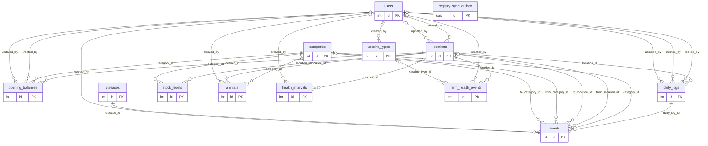

# Data model

Snapshot: 2026-10-08. This is declared source schema, not verified live schema. Every column is listed below.
Notation: `?` nullable; `!` NOT NULL; PK primary key; UQ unique; IX single-column index; FK names the target and delete behavior. Defaults are ORM-side unless marked server. SQLAlchemy Column without nullable is nullable unless PK; Mapped annotations infer nullability and SQL type when omitted.

## users / User
Source: `backend/models.py:32`.

- `id: Integer ! [PK; IX]`; `phone: String(20) ! [UQ; IX]`; `password_hash: String(255) !`.
- `name: String(100) !`; `role: SQLEnum(UserRole) ! [default=UserRole.VIEWER]`; `is_active: Boolean ? [default=True]`.
- `created_at: DateTime(timezone=True) ? [default=UTC now]`; `updated_at: DateTime(timezone=True) ? [default=UTC now; onupdate=UTC now]`.
- ORM relationships: none declared.

## locations / Location
Source: `backend/models.py:44`.

- `id: Integer ! [PK; IX]`; `name: String(100) ! [UQ]`; `description: Text ?`.
- `is_active: Boolean ? [default=True]`; `created_at: DateTime(timezone=True) ? [default=UTC now]`; `created_by: Integer ? [FK users.id]`.
- `updated_at: DateTime(timezone=True) ? [default=UTC now; onupdate=UTC now]`; `updated_by: Integer ? [FK users.id]`.
- ORM relationships: none declared.

## categories / Category
Source: `backend/models.py:56`.

- `id: Integer ! [PK; IX]`; `name_sw: String(100) !`; `name_en: String(100) !`.
- `species: SQLEnum(SpeciesType) !`; `sort_order: Integer ? [default=0]`; `is_active: Boolean ? [default=True]`.
- Table constraints/indexes: `(UniqueConstraint('name_sw', 'species', name='uq_category_species'),)`.
- ORM relationships: none declared.

## opening_balances / OpeningBalance
Source: `backend/models.py:68`.

- `id: Integer ! [PK; IX]`; `location_id: Integer ! [FK locations.id]`; `species: SQLEnum(SpeciesType) !`.
- `category_id: Integer ! [FK categories.id]`; `count: Integer ! [default=0]`; `period_start: Date !`.
- `created_at: DateTime(timezone=True) ? [default=UTC now]`; `created_by: Integer ? [FK users.id]`; `updated_at: DateTime(timezone=True) ? [default=UTC now; onupdate=UTC now]`.
- `updated_by: Integer ? [FK users.id]`.
- Table constraints/indexes: `(UniqueConstraint('location_id', 'species', 'category_id', 'period_start', name='uq_opening_balance'),)`.
- ORM relationships: `location=relationship('Location')`; `category=relationship('Category')`.

## daily_logs / DailyLog
Source: `backend/models.py:87`.

- `id: Integer ! [PK; IX]`; `location_id: Integer ! [FK locations.id]`; `log_date: Date !`.
- `has_events: Boolean ? [default=False]`; `notes: Text ?`; `is_locked: Boolean ? [default=False]`.
- `locked_by: Integer ? [FK users.id]`; `locked_at: DateTime(timezone=True) ?`; `created_at: DateTime(timezone=True) ? [default=UTC now]`.
- `created_by: Integer ? [FK users.id]`; `updated_at: DateTime(timezone=True) ? [default=UTC now; onupdate=UTC now]`; `updated_by: Integer ? [FK users.id]`.
- Table constraints/indexes: `(UniqueConstraint('location_id', 'log_date', name='uq_daily_log'),)`.
- ORM relationships: `location=relationship('Location')`; `events=relationship('Event', back_populates='daily_log', cascade='all, delete-orphan')`.

## diseases / Disease
Source: `backend/models.py:129`.

- `id: Integer ! [PK; IX]`; `name: String(255) ! [UQ]`; `description: Text ?`.
- `species: SQLEnum(SpeciesType) ?`; `is_active: Boolean ? [default=True]`; `created_at: DateTime(timezone=True) ? [default=UTC now]`.
- ORM relationships: none declared.

## events / Event
Source: `backend/models.py:140`.

- `id: Integer ! [PK; IX]`; `daily_log_id: Integer ! [FK daily_logs.id]`; `event_type: SQLEnum(EventType) !`.
- `species: SQLEnum(SpeciesType) !`; `category_id: Integer ? [FK categories.id]`; `count: Integer ! [default=0]`.
- `from_location_id: Integer ? [FK locations.id]`; `to_location_id: Integer ? [FK locations.id]`; `from_category_id: Integer ? [FK categories.id]`.
- `to_category_id: Integer ? [FK categories.id]`; `notes: Text ?`; `is_stock_event: Boolean ? [default=True]`.
- `animal_tags: Text ?`; `cause_of_death: String(255) ?`; `disease_id: Integer ? [FK diseases.id]`.
- `days_sick: Integer ?`; `attending_vet: String(255) ?`; `abortion_stage: SQLEnum(AbortionStage) ?`.
- `mother_tag: String(100) ?`; `offspring_tags: Text ?`; `buyer_name: String(255) ?`.
- `buyer_phone: String(50) ?`; `buyer_address: Text ?`; `sale_price: Integer ?`.
- `gift_party_name: String(255) ?`; `gift_party_phone: String(50) ?`; `gift_reason: Text ?`.
- `created_at: DateTime(timezone=True) ? [default=UTC now]`; `created_by: Integer ? [FK users.id]`.
- ORM relationships: `daily_log=relationship('DailyLog', back_populates='events')`; `category=relationship('Category', foreign_keys=[category_id])`; `from_category=relationship('Category', foreign_keys=[from_category_id])`; `to_category=relationship('Category', foreign_keys=[to_category_id])`; `from_location=relationship('Location', foreign_keys=[from_location_id])`; `to_location=relationship('Location', foreign_keys=[to_location_id])`; `disease=relationship('Disease', foreign_keys=[disease_id])`.

## stock_levels / StockLevel
Source: `backend/models.py:196`.

- `id: Integer ! [PK; IX]`; `location_id: Integer ! [FK locations.id]`; `species: SQLEnum(SpeciesType) !`.
- `category_id: Integer ! [FK categories.id]`; `current_count: Integer ! [default=0]`; `last_updated: DateTime(timezone=True) ? [default=UTC now]`.
- Table constraints/indexes: `(UniqueConstraint('location_id', 'species', 'category_id', name='uq_stock_level'),)`.
- ORM relationships: `location=relationship('Location')`; `category=relationship('Category')`.

## animals / Animal
Source: `backend/models.py:212`.

- `id: Integer ! [PK; IX]`; `tag_number: String(100) ! [IX]`; `name: String(100) ?`.
- `species: SQLEnum(SpeciesType) !`; `category_id: Integer ! [FK categories.id]`; `location_id: Integer ! [FK locations.id]`.
- `sex: SQLEnum(AnimalSex) !`; `birth_date: Date ?`; `mother_tag: String(100) ?`.
- `father_tag: String(100) ?`; `acquisition_type: SQLEnum(AnimalAcquisitionType) !`; `acquisition_date: Date !`.
- `status: SQLEnum(AnimalStatus) ! [default=AnimalStatus.ACTIVE]`; `status_changed_at: DateTime(timezone=True) ?`; `notes: Text ?`.
- `registry_tag_id: String(100) ? [IX]`; `created_by: Integer ? [FK users.id]`; `created_at: DateTime(timezone=True) ? [default=UTC now]`.
- `updated_at: DateTime(timezone=True) ? [default=UTC now; onupdate=UTC now]`.
- Table constraints/indexes: `(UniqueConstraint('tag_number', 'species', 'location_id', name='uq_animal_tag'),)`.
- ORM relationships: `category=relationship('Category')`; `location=relationship('Location')`; `creator=relationship('User', foreign_keys=[created_by])`.

## health_intervals / HealthInterval
Source: `backend/models.py:254`.

- `id: Integer ! [PK; IX]`; `location_id: Integer ! [FK locations.id]`; `species: SQLEnum(SpeciesType) !`.
- `event_type: SQLEnum(HealthEventType) !`; `interval_days: Integer !`; `notes: Text ?`.
- `created_by: Integer ? [FK users.id]`; `created_at: DateTime(timezone=True) ? [default=UTC now]`; `updated_at: DateTime(timezone=True) ? [default=UTC now; onupdate=UTC now]`.
- Table constraints/indexes: `(UniqueConstraint('location_id', 'species', 'event_type', name='uq_health_interval'),)`.
- ORM relationships: `location=relationship('Location')`; `creator=relationship('User', foreign_keys=[created_by])`.

## farm_health_events / FarmHealthEvent
Source: `backend/models.py:274`.

- `id: Integer ! [PK; IX]`; `location_id: Integer ! [FK locations.id]`; `event_type: SQLEnum(HealthEventType) !`.
- `event_date: Date !`; `species: SQLEnum(SpeciesType) ?`; `category_scope: SQLEnum(CategoryScope) ?`.
- `category_ids: JSON ?`; `product_name: String(255) ?`; `dosage: String(100) ?`.
- `cost_per_head: Float ?`; `total_cost: Float ?`; `head_count: Integer ?`.
- `next_due_date: Date ?`; `notes: Text ?`; `created_by: Integer ? [FK users.id]`.
- `created_at: DateTime(timezone=True) ? [default=UTC now]`; `updated_at: DateTime(timezone=True) ? [default=UTC now; onupdate=UTC now]`; `vaccine_type_id: Integer ? [FK vaccine_types.id]`.
- ORM relationships: `location=relationship('Location')`; `creator=relationship('User', foreign_keys=[created_by])`; `vaccine_type=relationship('VaccineType')`.

## vaccine_types / VaccineType
Source: `backend/models.py:302`.

- `id: Integer ! [PK; IX]`; `name: String(255) ! [UQ]`; `description: Text ?`.
- `species_applicability: JSON ?`; `default_interval_days: Integer ?`; `is_active: Boolean ? [default=True]`.
- `created_by: Integer ? [FK users.id]`; `created_at: DateTime(timezone=True) ? [default=UTC now]`; `updated_at: DateTime(timezone=True) ?`.
- ORM relationships: `creator=relationship('User', foreign_keys=[created_by])`.

## registry_sync_outbox / RegistrySyncOutbox
Source: `backend/models.py:332`.

- `id: UUID(as_uuid=True) ! [PK; default=uuid.uuid4]`; `source_event_id: String(100) ! [UQ; IX]`; `tag_id: String(100) ! [IX]`.
- `action: SQLEnum(RegistrySyncAction) !`; `intended_status: String(50) ?`; `previous_status: String(50) ?`.
- `payload: JSONB !`; `state: SQLEnum(RegistrySyncState) ! [default=RegistrySyncState.PENDING]`; `attempts: Integer ! [default=0]`.
- `last_error: Text ?`; `created_at: DateTime(timezone=True) ? [default=UTC now]`; `sent_at: DateTime(timezone=True) ?`.
- ORM relationships: none declared.

## Enum values

- `UserRole`: ADMIN=admin, DATA_ENTRY=data_entry, VIEWER=viewer (`backend/models.py:9`).
- `EventType`: BIRTH=birth, DEATH=death, SOLD=sold, MISSING=missing, GIFT_IN=gift_in, GIFT_OUT=gift_out, BOUGHT=bought, TRANSFER=transfer, CATEGORY_CHANGE=category_change, ABORTION=abortion, WEANING=weaning (`backend/models.py:14`).
- `SpeciesType`: CATTLE=cattle, SHEEP=sheep, GOAT=goat (`backend/models.py:27`).
- `AbortionStage`: EARLY=early, MID=mid, LATE=late (`backend/models.py:108`).
- `AnimalSex`: MALE=male, FEMALE=female (`backend/models.py:113`).
- `AnimalAcquisitionType`: BORN=born, BOUGHT=bought, GIFT_IN=gift_in (`backend/models.py:117`).
- `AnimalStatus`: ACTIVE=active, SOLD=sold, DEAD=dead, TRANSFERRED=transferred, MISSING=missing (`backend/models.py:122`).
- `HealthEventType`: DIPPING=dipping, VACCINATION=vaccination, DEWORMING=deworming, LOG=log (`backend/models.py:243`).
- `CategoryScope`: ALL=all, SPECIFIC=specific (`backend/models.py:249`).
- `RegistrySyncAction`: STATUS_CHANGE=STATUS_CHANGE, EVENT=EVENT, REVERT=REVERT (`backend/models.py:319`).
- `RegistrySyncState`: PENDING=PENDING, SENT=SENT, FAILED=FAILED, CONFLICT=CONFLICT (`backend/models.py:325`).

## Foreign-key ER diagram

Diagram shows physical foreign keys only. Free-text category/location/status/tag references and JSON arrays do not imply relational constraints.

## Schema safety and future non-additive changes

- High: startup uses create_all plus a small set of nullable ALTER additions; it does not evolve existing enum types, nullability or constraints (`backend/server.py:98`, `backend/database.py:55`). Alembic is installed but no migration directory/config is present.
- Required policy: nullable `ADD COLUMN IF NOT EXISTS` only for future column additions. Never rely on create_all to change an existing table. New tables/indexes need an explicit reviewed plan; this analysis executes no DDL.
- Non-additive candidates: `animals.birth_date/status/tag_number/sex/species/category_id/location_id` if identity ownership moves to Registry; do not drop/rename/retype these in place (`backend/models.py:212`). Introduce nullable references/projections and transition reads first.
- `animals` uniqueness includes mutable location, and `registry_tag_id` is indexed but not unique (`backend/models.py:231`, `backend/models.py:240`); global identity enforcement requires reconciliation before any uniqueness change.
- SQLEnum-backed user roles, species, event types, abortion stages, animal sex/acquisition/status, health event/scope and outbox action/state require explicit PostgreSQL enum work if members change. Python enum edits alone are insufficient (`backend/models.py:9`).
- `events.animal_tags/offspring_tags` CSV text, `farm_health_events.category_ids` JSON, Float costs, and integer sale_price require a parallel representation/backfill if normalized or made precise; no destructive conversion (`backend/models.py:159`, `backend/models.py:178`, `backend/models.py:284`).
- Medium index candidates from actual reads: `events(daily_log_id)` for joins; `daily_logs(log_date)` for global range reports; `farm_health_events(location_id,event_type,species,event_date)` / next_due_date; outbox state+created_at for drain. Existing PK/UQ indexes are listed above; validate with query plans later (`backend/server.py:2014`, `backend/server.py:3658`, `backend/registry_sync.py:111`).
