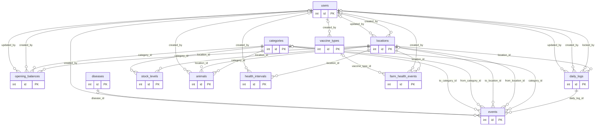

# Data model

> **Updated 2026-11-08:** the Herd Tag Registry integration was removed from the application (docs/decisions/0007). Content below was trimmed accordingly; line numbers are from the 2026-10-08 snapshot and have shifted. Treat anything still mentioning the Registry as historical.

Snapshot: 2026-10-08. This is declared source schema, not verified live schema. Every column is listed below.
Notation: `?` nullable; `!` NOT NULL; PK primary key; UQ unique; IX single-column index; FK names the target and delete behavior. Defaults are ORM-side unless marked server. SQLAlchemy Column without nullable is nullable unless PK; Mapped annotations infer nullability and SQL type when omitted.

## users / User
Source: `backend/models.py:32`.

- `id: Integer ! [PK; IX]`; `phone: String(20) ! [UQ; IX]`; `password_hash: String(255) !`.
- `name: String(100) !`; `role: SQLEnum(UserRole) ! [default=UserRole.VIEWER]`; `is_active: Boolean ? [default=True]`.
- `created_at: DateTime(timezone=True) ? [default=UTC now]`; `updated_at: DateTime(timezone=True) ? [default=UTC now; onupdate=UTC now]`.
- ORM relationships: none declared.

## locations / Location
Source: `backend/models.py:44`.

- `id: Integer ! [PK; IX]`; `name: String(100) ! [UQ]`; `description: Text ?`.
- `is_active: Boolean ? [default=True]`; `created_at: DateTime(timezone=True) ? [default=UTC now]`; `created_by: Integer ? [FK users.id]`.
- `updated_at: DateTime(timezone=True) ? [default=UTC now; onupdate=UTC now]`; `updated_by: Integer ? [FK users.id]`.
- ORM relationships: none declared.

## categories / Category
Source: `backend/models.py:56`.

- `id: Integer ! [PK; IX]`; `name_sw: String(100) !`; `name_en: String(100) !`.
- `species: SQLEnum(SpeciesType) !`; `sort_order: Integer ? [default=0]`; `is_active: Boolean ? [default=True]`.
- Table constraints/indexes: `(UniqueConstraint('name_sw', 'species', name='uq_category_species'),)`.
- ORM relationships: none declared.

## opening_balances / OpeningBalance
Source: `backend/models.py:68`.

- `id: Integer ! [PK; IX]`; `location_id: Integer ! [FK locations.id]`; `species: SQLEnum(SpeciesType) !`.
- `category_id: Integer ! [FK categories.id]`; `count: Integer ! [default=0]`; `period_start: Date !`.
- `created_at: DateTime(timezone=True) ? [default=UTC now]`; `created_by: Integer ? [FK users.id]`; `updated_at: DateTime(timezone=True) ? [default=UTC now; onupdate=UTC now]`.
- `updated_by: Integer ? [FK users.id]`.
- Table constraints/indexes: `(UniqueConstraint('location_id', 'species', 'category_id', 'period_start', name='uq_opening_balance'),)`.
- ORM relationships: `location=relationship('Location')`; `category=relationship('Category')`.

## daily_logs / DailyLog
Source: `backend/models.py:87`.

- `id: Integer ! [PK; IX]`; `location_id: Integer ! [FK locations.id]`; `log_date: Date !`.
- `has_events: Boolean ? [default=False]`; `notes: Text ?`; `is_locked: Boolean ? [default=False]`.
- `locked_by: Integer ? [FK users.id]`; `locked_at: DateTime(timezone=True) ?`; `created_at: DateTime(timezone=True) ? [default=UTC now]`.
- `created_by: Integer ? [FK users.id]`; `updated_at: DateTime(timezone=True) ? [default=UTC now; onupdate=UTC now]`; `updated_by: Integer ? [FK users.id]`.
- Table constraints/indexes: `(UniqueConstraint('location_id', 'log_date', name='uq_daily_log'),)`.
- ORM relationships: `location=relationship('Location')`; `events=relationship('Event', back_populates='daily_log', cascade='all, delete-orphan')`.

## diseases / Disease
Source: `backend/models.py:129`.

- `id: Integer ! [PK; IX]`; `name: String(255) ! [UQ]`; `description: Text ?`.
- `species: SQLEnum(SpeciesType) ?`; `is_active: Boolean ? [default=True]`; `created_at: DateTime(timezone=True) ? [default=UTC now]`.
- ORM relationships: none declared.

## events / Event
Source: `backend/models.py:140`.

- `id: Integer ! [PK; IX]`; `daily_log_id: Integer ! [FK daily_logs.id]`; `event_type: SQLEnum(EventType) !`.
- `species: SQLEnum(SpeciesType) !`; `category_id: Integer ? [FK categories.id]`; `count: Integer ! [default=0]`.
- `from_location_id: Integer ? [FK locations.id]`; `to_location_id: Integer ? [FK locations.id]`; `from_category_id: Integer ? [FK categories.id]`.
- `to_category_id: Integer ? [FK categories.id]`; `notes: Text ?`; `is_stock_event: Boolean ? [default=True]`.
- `animal_tags: Text ?`; `cause_of_death: String(255) ?`; `disease_id: Integer ? [FK diseases.id]`.
- `days_sick: Integer ?`; `attending_vet: String(255) ?`; `abortion_stage: SQLEnum(AbortionStage) ?`.
- `mother_tag: String(100) ?`; `offspring_tags: Text ?`; `buyer_name: String(255) ?`.
- `buyer_phone: String(50) ?`; `buyer_address: Text ?`; `sale_price: Integer ?`.
- `gift_party_name: String(255) ?`; `gift_party_phone: String(50) ?`; `gift_reason: Text ?`.
- `created_at: DateTime(timezone=True) ? [default=UTC now]`; `created_by: Integer ? [FK users.id]`.
- ORM relationships: `daily_log=relationship('DailyLog', back_populates='events')`; `category=relationship('Category', foreign_keys=[category_id])`; `from_category=relationship('Category', foreign_keys=[from_category_id])`; `to_category=relationship('Category', foreign_keys=[to_category_id])`; `from_location=relationship('Location', foreign_keys=[from_location_id])`; `to_location=relationship('Location', foreign_keys=[to_location_id])`; `disease=relationship('Disease', foreign_keys=[disease_id])`.

## stock_levels / StockLevel
Source: `backend/models.py:196`.

- `id: Integer ! [PK; IX]`; `location_id: Integer ! [FK locations.id]`; `species: SQLEnum(SpeciesType) !`.
- `category_id: Integer ! [FK categories.id]`; `current_count: Integer ! [default=0]`; `last_updated: DateTime(timezone=True) ? [default=UTC now]`.
- Table constraints/indexes: `(UniqueConstraint('location_id', 'species', 'category_id', name='uq_stock_level'),)`.
- ORM relationships: `location=relationship('Location')`; `category=relationship('Category')`.

## animals / Animal
Source: `backend/models.py:212`.

- `id: Integer ! [PK; IX]`; `tag_number: String(100) ! [IX]`; `name: String(100) ?`.
- `species: SQLEnum(SpeciesType) !`; `category_id: Integer ! [FK categories.id]`; `location_id: Integer ! [FK locations.id]`.
- `sex: SQLEnum(AnimalSex) !`; `birth_date: Date ?`; `mother_tag: String(100) ?`.
- `father_tag: String(100) ?`; `acquisition_type: SQLEnum(AnimalAcquisitionType) !`; `acquisition_date: Date !`.
- `status: SQLEnum(AnimalStatus) ! [default=AnimalStatus.ACTIVE]`; `status_changed_at: DateTime(timezone=True) ?`; `notes: Text ?`.
- `registry_tag_id: String(100) ? [IX]`; `is_temp_tag: Boolean ! [default=False; server_default 'false']` (added 2026-11-08 via startup `ADD COLUMN IF NOT EXISTS is_temp_tag BOOLEAN DEFAULT FALSE`, nullable in existing PostgreSQL databases; the model says NOT NULL for fresh/SQLite databases; true while the tag is a generated `TEMP-<LOC>-<YYYYMMDD>-NNN` placeholder).
- `lifetime_calvings: Integer ?` (added 2026-11-20 via startup `ADD COLUMN IF NOT EXISTS lifetime_calvings INTEGER`; derived count of `reproductive_cycles` rows with `calving_outcome` in LIVE_CALF/STILLBIRTH/ASSISTED_LIVE/ASSISTED_DEAD (abortions excluded); NULL = not backfilled; backfilled by a one-off manual UPDATE, not by startup code; afterwards `_sync_lifetime_calvings` (server.py, next to the reproductive-cycle routes) recounts it after cycle create / `calving_outcome` update / delete, best-effort in a savepoint with warnings only; reproductive_events and the daily-log sync do not write cycles so they do not touch it; no API exposes it yet).
- `created_by: Integer ? [FK users.id]`; `created_at: DateTime(timezone=True) ? [default=UTC now]`.
- `updated_at: DateTime(timezone=True) ? [default=UTC now; onupdate=UTC now]`.
- Table constraints/indexes: `(UniqueConstraint('tag_number', 'species', 'location_id', name='uq_animal_tag'),)`.
- ORM relationships: `category=relationship('Category')`; `location=relationship('Location')`; `creator=relationship('User', foreign_keys=[created_by])`.

## health_intervals / HealthInterval
Source: `backend/models.py:254`.

- `id: Integer ! [PK; IX]`; `location_id: Integer ! [FK locations.id]`; `species: SQLEnum(SpeciesType) !`.
- `event_type: SQLEnum(HealthEventType) !`; `interval_days: Integer !`; `notes: Text ?`.
- `created_by: Integer ? [FK users.id]`; `created_at: DateTime(timezone=True) ? [default=UTC now]`; `updated_at: DateTime(timezone=True) ? [default=UTC now; onupdate=UTC now]`.
- Table constraints/indexes: `(UniqueConstraint('location_id', 'species', 'event_type', name='uq_health_interval'),)`.
- ORM relationships: `location=relationship('Location')`; `creator=relationship('User', foreign_keys=[created_by])`.

## farm_health_events / FarmHealthEvent
Source: `backend/models.py:274`.

- `id: Integer ! [PK; IX]`; `location_id: Integer ! [FK locations.id]`; `event_type: SQLEnum(HealthEventType) !`.
- `event_date: Date !`; `species: SQLEnum(SpeciesType) ?`; `category_scope: SQLEnum(CategoryScope) ?`.
- `category_ids: JSON ?`; `product_name: String(255) ?`; `dosage: String(100) ?`.
- `cost_per_head: Float ?`; `total_cost: Float ?`; `head_count: Integer ?`.
- `next_due_date: Date ?`; `notes: Text ?`; `created_by: Integer ? [FK users.id]`.
- `created_at: DateTime(timezone=True) ? [default=UTC now]`; `updated_at: DateTime(timezone=True) ? [default=UTC now; onupdate=UTC now]`; `vaccine_type_id: Integer ? [FK vaccine_types.id]`.
- ORM relationships: `location=relationship('Location')`; `creator=relationship('User', foreign_keys=[created_by])`; `vaccine_type=relationship('VaccineType')`.

## vaccine_types / VaccineType
Source: `backend/models.py:302`.

- `id: Integer ! [PK; IX]`; `name: String(255) ! [UQ]`; `description: Text ?`.
- `species_applicability: JSON ?`; `default_interval_days: Integer ?`; `is_active: Boolean ? [default=True]`.
- `created_by: Integer ? [FK users.id]`; `created_at: DateTime(timezone=True) ? [default=UTC now]`; `updated_at: DateTime(timezone=True) ?`.
- ORM relationships: `creator=relationship('User', foreign_keys=[created_by])`.

## registry_sync_outbox (legacy, not in models.py)
Table remains in existing databases as inert data (columns were: id UUID PK, source_event_id, tag_id, action, intended_status, previous_status, payload JSONB, state, attempts, last_error, created_at, sent_at). The ORM model and its enums were removed 2026-11-08. Never drop it in routine work; fresh databases will not create it.

## Enum values

- `UserRole`: ADMIN=admin, DATA_ENTRY=data_entry, VIEWER=viewer (`backend/models.py:9`).
- `EventType`: BIRTH=birth, DEATH=death, SOLD=sold, MISSING=missing, GIFT_IN=gift_in, GIFT_OUT=gift_out, BOUGHT=bought, TRANSFER=transfer, CATEGORY_CHANGE=category_change, ABORTION=abortion, WEANING=weaning (`backend/models.py:14`).
- `SpeciesType`: CATTLE=cattle, SHEEP=sheep, GOAT=goat (`backend/models.py:27`).
- `AbortionStage`: EARLY=early, MID=mid, LATE=late (`backend/models.py:108`).
- `AnimalSex`: MALE=male, FEMALE=female (`backend/models.py:113`).
- `AnimalAcquisitionType`: BORN=born, BOUGHT=bought, GIFT_IN=gift_in (`backend/models.py:117`).
- `AnimalStatus`: ACTIVE=active, SOLD=sold, DEAD=dead, TRANSFERRED=transferred, MISSING=missing (`backend/models.py:122`).
- `HealthEventType`: DIPPING=dipping, VACCINATION=vaccination, DEWORMING=deworming, LOG=log (`backend/models.py:243`).
- `CategoryScope`: ALL=all, SPECIFIC=specific (`backend/models.py:249`).

## Foreign-key ER diagram

Diagram shows physical foreign keys only. Free-text category/location/status/tag references and JSON arrays do not imply relational constraints.

## Reproduction and animal profile tables (added 2026-11-08)
Source: `backend/models.py` (appended block "REPRODUCTION & ANIMAL PROFILE"). New tables only; no existing table, column or enum changed. Created by `create_all` on next startup. PostgreSQL enum labels are the uppercase member NAMES (same as every existing enum); Python/API values are lowercase.
New enums: `ServiceType {natural, ai}`, `PDResult {pregnant, open, repeat}`, `ReproductiveCycleStatus {open, served, pregnant, calved, aborted}`, `CalvingOutcome {live_calf, stillbirth, abortion, assisted_live, assisted_dead}`, `NoteType {observation, weight, measurement, incident, health, other}`. Reused: `AnimalSex`, `AbortionStage`.

## bull_assignments / BullAssignment
- `id: Integer ! [PK; IX]`; `bull_animal_id: Integer ! [FK animals.id]`; `location_id: Integer ! [FK locations.id]`.
- `assigned_date: Date !`; `removed_date: Date ?` (null = still assigned); `notes: Text ?`.
- `created_by: Integer ? [FK users.id]`; `created_at: DateTime(timezone=True) ? [default=UTC now]`.
- Constraint: `uq_bull_assignment (bull_animal_id, location_id, assigned_date)`. Relationships: `bull` (Animal), `location`.

## reproductive_cycles / ReproductiveCycle
- `id: Integer ! [PK; IX]`; `animal_id: Integer ! [FK animals.id; IX]`; `cycle_number: Integer !` (1 = first recorded, MAX+1 per animal; not renumbered on delete).
- `bull_assignment_id: Integer ? [FK bull_assignments.id]`; `service_date: Date ?`; `service_type: SQLEnum(ServiceType) ? [default NATURAL]`.
- `pd_check_date: Date ?`; `pd_result: SQLEnum(PDResult) ?`; `pd_months_pregnant: Integer ?`.
- `expected_calving_date: Date ?` (service_date + 283 days unless supplied); `actual_calving_date: Date ?`; `calving_outcome: SQLEnum(CalvingOutcome) ?`.
- `calf_sex: SQLEnum(AnimalSex) ?`; `calf_animal_id: Integer ? [FK animals.id]`; `abortion_stage: SQLEnum(AbortionStage) ?`.
- `bcs_at_service`, `bcs_at_calving: Numeric(3,1) ?` (API validates 1.0-5.0).
- `calving_interval_days`, `days_to_service: Integer ?` (computed on save from the previous cycle that has an `actual_calving_date`).
- `status: SQLEnum(ReproductiveCycleStatus) ! [default OPEN]`; `notes: Text ?`; `created_by: Integer ? [FK users.id]`; `created_at`, `updated_at: DateTime(timezone=True)`.
- Constraint: `uq_repro_cycle (animal_id, cycle_number)`. Relationships: `animal`, `bull_assignment`, `calf`.

## bcs_records / BCSRecord
- `id: Integer ! [PK; IX]`; `animal_id: Integer ! [FK animals.id; IX]`; `score_date: Date !`; `bcs: Numeric(3,1) !`; `scored_by: String(255) ?`; `notes: Text ?`.
- `created_by: Integer ? [FK users.id]`; `created_at: DateTime(timezone=True)`.

## animal_photos / AnimalPhoto
- `id: Integer ! [PK; IX]`; `animal_id: Integer ! [FK animals.id; IX]`; `gcs_path: String(500) !` (object path `animals/{animal_id}/{uuid}.{ext}`, never a URL).
- `caption: String(255) ?`; `taken_date: Date ?`; `is_primary: Boolean ! [default False]`; `uploaded_by: Integer ? [FK users.id]`; `uploaded_at: DateTime(timezone=True)`.

## animal_notes / AnimalNote
- `id: Integer ! [PK; IX]`; `animal_id: Integer ! [FK animals.id; IX]`; `note_date: Date !`; `note_type: SQLEnum(NoteType) ! [default OBSERVATION]`; `content: Text !`.
- `created_by: Integer ? [FK users.id]`; `created_at`, `updated_at: DateTime(timezone=True)`.

Rollback for this change (manual, only if needed and after checking the tables are empty): `DROP TABLE reproductive_cycles, bull_assignments, bcs_records, animal_photos, animal_notes;` then `DROP TYPE servicetype, pdresult, calvingoutcome, reproductivecyclestatus, notetype;`. Do NOT drop `abortionstage` or `animalsex`: existing tables use them.

## animal_location_history / AnimalLocationHistory (added 2026-11-08)
Append-only log of animal moves; written by the event-to-register sync on TRANSFER events (decision 0009). Created by `create_all` (new table, no DDL line).
- `id: Integer ! [PK; IX]`; `animal_id: Integer ! [FK animals.id; IX]`; `from_location_id: Integer ? [FK locations.id]` (null = first recorded location).
- `to_location_id: Integer ! [FK locations.id]`; `moved_date: Date !`; `event_id: Integer ? [FK events.id; IX]` (null for manual moves, or when the source event was deleted).
- `notes: Text ?`; `created_by: Integer ? [FK users.id]`; `created_at: DateTime(timezone=True) ? [default=UTC now]`.
- ORM relationships: `animal`, `from_location`, `to_location`.
- Rollback (manual, only if the table is empty or its data is not needed): `DROP TABLE animal_location_history;`

## Schema safety and future non-additive changes

- High: startup uses create_all plus a small set of nullable ALTER additions; it does not evolve existing enum types, nullability or constraints (`backend/server.py:98`, `backend/database.py:55`). Alembic is installed but no migration directory/config is present.
- Required policy: nullable `ADD COLUMN IF NOT EXISTS` only for future column additions. Never rely on create_all to change an existing table. New tables/indexes need an explicit reviewed plan; this analysis executes no DDL.
- Non-additive candidates: `animals.birth_date/status/tag_number/sex/species/category_id/location_id` if identity ownership changes; do not drop/rename/retype these in place (`backend/models.py:212`). Introduce nullable references/projections and transition reads first.
- `animals` uniqueness includes mutable location, and `registry_tag_id` is indexed but not unique (inert legacy column) (`backend/models.py:231`, `backend/models.py:240`); global identity enforcement requires reconciliation before any uniqueness change.
- SQLEnum-backed user roles, species, event types, abortion stages, animal sex/acquisition/status, health event/scope require explicit PostgreSQL enum work if members change. Python enum edits alone are insufficient (`backend/models.py:9`).
- `events.animal_tags/offspring_tags` CSV text, `farm_health_events.category_ids` JSON, Float costs, and integer sale_price require a parallel representation/backfill if normalized or made precise; no destructive conversion (`backend/models.py:159`, `backend/models.py:178`, `backend/models.py:284`).
- Added 2026-11-10 (script `backend/migrations/add_perf_indexes.sql`, models `__table_args__`): animals `ix_animals_{location_id,category_id,reproductive_status,birth_date}`, `ix_animals_species_category_status (species, category_id, status)`, `ix_animals_location_status (location_id, status)`; `ix_daily_logs_log_date`; `ix_events_daily_log_id`, `ix_events_event_type`; `ix_repro_events_{event_type,event_date}`, `ix_repro_events_animal_date (animal_id, event_date)`; `ix_animal_identifiers_id_value`, `ix_animal_identifiers_type_value (id_type, id_value)`; `ix_category_transitions_date`; `ix_recon_entries_match_status`. Existing DBs get them only when the owner runs the SQL.
- Remaining index candidates: `farm_health_events(location_id,event_type,species,event_date)` / next_due_date. Existing PK/UQ indexes are listed above; validate with query plans later (`backend/server.py:2014`, `backend/server.py:3658`).

## Category transitions (added 2026-11-10)
- `category_transition_rules`: id, species, from_category_id, to_category_id_f, to_category_id_m (nullable FKs to categories), trigger_type (`TransitionTriggerType`: AGE|EVENT), trigger_age_months, trigger_event (e.g. `first_calving`), is_active, notes. Unique `(species, from_category_id, trigger_type)`. Seeded at startup (15 rows, only missing ones inserted; edited rules are never overwritten): youngest -> Achishwa Dume/Jike at 7 months, Achishwa Dume -> Dume Wadogo and Achishwa Jike -> Mitamba at 18 months, Mitamba -> Koo on `first_calving`. Cattle youngest = Ndama Dume/Jike; sheep and goats = Vichinda Dume/Jike.
- `category_transitions`: id, animal_id (indexed), rule_id (nullable), from_category_id, to_category_id, transition_date, trigger (`age_7m`, `first_calving`, `manual`), notes, confirmed_by, created_at.
- Additive only: two new tables and one new PG enum type; no existing table touched.

### Daily-log reproductive sync (2026-11-10)
Events now include nullable `pd_result` and `months_pregnant`, with enum additions
`PD_TEST` and `SERVICE`. New `event_animal_links` supports multiple animals and
roles per event, durable links after retagging, and reproductive replay after
edits/deletion. See [operations and limitations](../DAILY_REPRODUCTIVE_SYNC.md).
